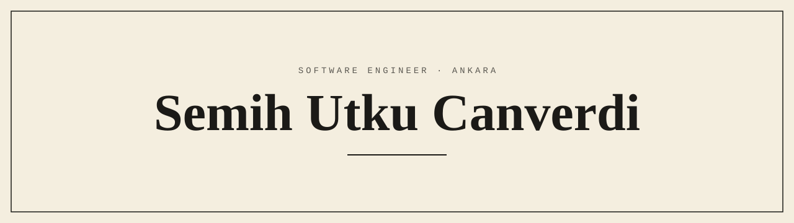

  

  <a href="https://utkucanverdi.vercel.app">Website</a> &nbsp;/&nbsp;
  <a href="https://tr.linkedin.com/in/semihutkucanverdi">LinkedIn</a> &nbsp;/&nbsp;
  <a href="https://utkucanverdi.vercel.app/#cv-section">Résumé</a> &nbsp;/&nbsp;
  <a href="mailto:utkucnvrdi@gmail.com">Get in touch</a>

 

I'm **Utku**, a software engineering student at **Çankaya University** in Ankara. I like building the whole system: backend services, web interfaces, data pipelines and ML models — and I'm especially drawn to **AI** and **FinTech**.

## Where I've worked

| When | Where | What |
|---|---|---|
| Sep 2026 – now | **VISTA Lab** | Deep learning & neural pipelines — piano fingering prediction with PyTorch |
| Jul – Aug 2026 | **TEİAŞ** | Internal web apps with Java, Spring Boot and Angular ([internship portal](https://github.com/sutkucanverdi/teias-stajalimportal)) |
| Jul 2025 – Jan 2026 | **TeamSec** | FastAPI & Streamlit services, React migration, Power BI, PostgreSQL tuning |

## Tech stack

  
  
  
  
  
  
  
  
  
  
  
  

